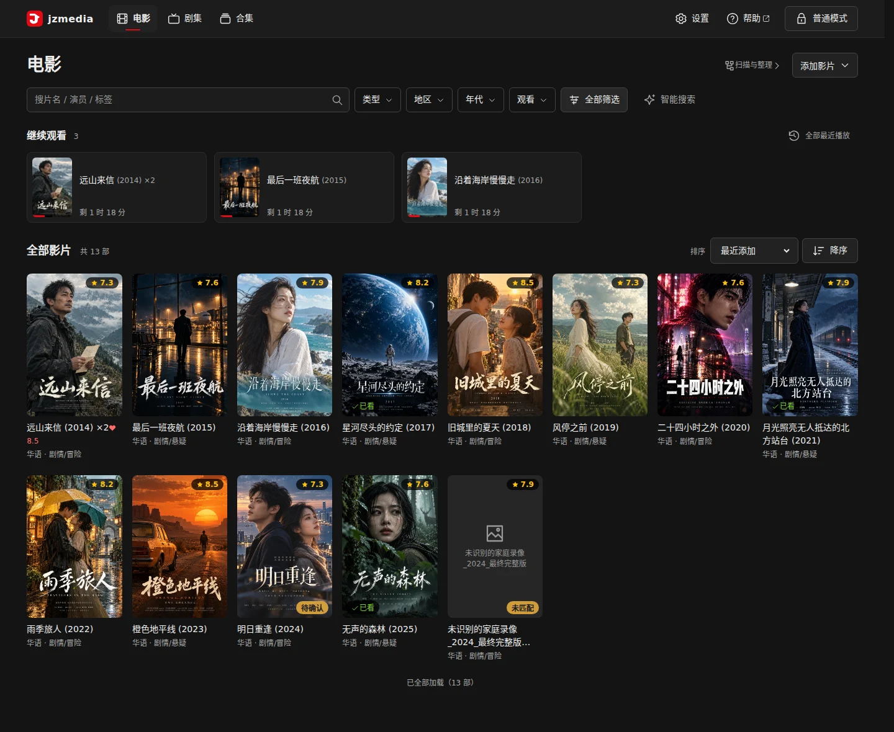

# jzmedia

**把硬盘里的电影和剧集，变成好找、好看、好管理的私人影视库。**

jzmedia 是面向家庭本地收藏的开源影视库。连接电脑或 NAS 上已有的媒体，在浏览器里逛海报墙、按演员找片、接着上次的位置观看，也能用 Android TV 客户端在电视上继续看。

[开始安装](docs/getting-started/deployment.md) · [下载发行版](https://github.com/nojobnopay/jzmedia/releases) · [版本说明](CHANGELOG.md) · [在线图文帮助](https://nojobnopay.github.io/jzmedia/) · [Android TV](android-tv/README.md#已有-apk安装并连接)

*界面演示使用虚构影片资料与原创海报。*

## 值得试试的特色

### 追剧时，看清播出进度和自己的收藏

这部剧还在连载吗？新一季播了多少，自己又收了多少？剧详情把播出状态、最近播出的分集和本库收藏放在一起；季页可切换“已收藏”和“全部分集”，对照官方目录查看未收藏与尚未播出的内容。海报墙还会每周展示近期已播、尚未收藏的新集，方便安排下一次补片。播出与分集资料依赖 TMDB 配置和网络。[了解追剧与收藏](docs/user-guide/watch-tv.md)

### 多版本收藏，各自记住看到哪里

同一部电影的不同剪辑版、不同画质可以放在同一详情中选择，每个文件独立保存断点。剧集也支持 V1/V2 多版本：从 V1 开始连播，就沿 V1 跨集、跨季继续，多集合一文件已覆盖的集号会跳过，当前版本结束后停止。收藏多个版本，也能按选定版本顺着看。[电影版本](docs/user-guide/movie-versions.md) · [剧集多版本](docs/user-guide/watch-tv.md#多版本与连续观看)

### 在网页里，也能保留字幕的样式

网页播放器支持 ASS/SSA 样式字幕和 PGS 图片字幕，ASS/SSA 尽量保留字体、位置与动画；Android TV 也支持 ASS/SSA 原生渲染。网页上可临时加载自己的字幕、调整同步时间，文本字幕还能改字号、描边和位置，在下黑边空间足够时自动放入黑边。遇到字体或渲染兼容问题，可使用简化字幕或烧录回退。[查看字幕功能](docs/user-guide/subtitles.md)

### 一句话，从自己的片库里找片

输入“找没看过的 90 年代香港喜剧，TMDB 7 分以上”，智能搜索会把要求转成可编辑的筛选条件，核对后再应用到当前片库。遇到难认的文件名，AI 匹配建议会辅助查找、排序真实资料源的候选，选中并确认后才绑定。智能辅助需自行配置模型服务与 API Key；普通搜索、筛选和手动匹配可独立使用。[试试智能搜索](docs/user-guide/find-movies.md#智能搜索) · [辅助核对匹配](docs/user-guide/metadata.md#辅助核对匹配)

### 整理收藏前，先看清每一处路径变化

扫描入库后就能观看，目录整理按需进行。想统一命名时，先预览原路径、目标路径和冲突，再选择执行范围；支持 Kodi/Plex 命名档，字幕与 NFO 等关联文件按整理规则一并移动。电影可预览还原首次入库位置，剧集可按历史批次预览撤销；源文件缺失或目标被占用时会跳过并提示。[整理电影](docs/user-guide/organizing.md) · [整理剧集与撤销](docs/user-guide/tv-organizing.md)

### 沿用现有片库，资料也能留在文件旁

支持本地目录、SMB 和 NFS；SMB 可直接读取共享，无需先做系统挂载，NFS 使用挂载方式。已有 NFO 与本地海报可用于离线入库，资料来源和优先级按视频库配置，也可按策略把资料写回媒体旁供其他软件读取。只想先体验时，可设为只读库，扫描、浏览与播放仍可使用。[连接片库](docs/user-guide/libraries.md) · [资料来源与 NFO](docs/user-guide/metadata.md#来源链与离线资料)

## 日常看片，也有这些方便之处

- **从收藏里发现下一部**：按类型、地区、年代、评分、标签和观看状态筛选；浏览演员/导演的库内作品，用合集收拢系列电影，查看“库中类似”。[找片与筛选](docs/user-guide/find-movies.md) · [合集与人物](docs/user-guide/collections.md)
- **按场合选择观看模式**：儿童模式自动筛选低风险内容，并允许家长纠正；隐私模式只展示你手动选择的内容，通过保护密码进入。网页与电视独立选择模式。[儿童模式与隐私模式](docs/user-guide/settings.md#儿童模式与隐私模式)
- **按设备和网络选择播放方式**：能直放时直接播放，需要兼容处理时重新封装、转换音频或转码；支持倍速、音轨切换和画质选择，播放信息可查看实际输出。[播放控件与画质](docs/user-guide/playback-controls.md)
- **跳转前先看一眼画面**：已有进度缩略图时，拖动即可预览；新入库视频会在夜间空闲时生成。适用的远程片源还可提前缓存或预转码到服务器。[进度预览与预缓存](docs/user-guide/playback-previews.md)
- **从电脑、手机看到电视**：网页适配桌面与手机，Android TV 用遥控器浏览、搜索和播放，并与网页共享观看进度；也可从网页向支持 DLNA 视频接收的电视投屏，格式支持取决于接收设备。[安装电视端](android-tv/README.md#已有-apk安装并连接) · [DLNA 投屏](docs/user-guide/playback-controls.md#投屏到电视)
- **在网页里打理文件**：上传影片或文件夹，预览视频、字幕和 NFO，按预览结果改名、移动。文件管理中的视频预览不记录观看进度，适合核对片源。[文件浏览与管理](docs/user-guide/files.md)

## 快速开始

先选一个小目录，完成第一次入库和试播：

1. **安装服务端**：跟随[安装教程](docs/getting-started/deployment.md)选择 Docker 或宿主直接运行。Docker 镜像可[从 GHCR 拉取](docs/getting-started/deployment.md#从-ghcr-拉取镜像)，也可在 [GitHub Releases](https://github.com/nojobnopay/jzmedia/releases) 下载 Linux amd64 镜像归档或源码归档。
2. **添加自己的媒体**：打开 `http://服务器地址:8080`，点击空库欢迎卡片“开始配置”，按[首次入库图解](docs/user-guide/onboarding.md)连接目录、扫描并核对资料。
3. **播放第一部影片**：从海报进入详情并试播。想在电视上看，再下载发行版中的 Android TV Debug APK，按[电视端安装与连接](android-tv/README.md#已有-apk安装并连接)接入同一服务。

影片由使用者自行提供，jzmedia 不提供下载源。

## 文档与帮助

[在线图文帮助](https://nojobnopay.github.io/jzmedia/)无需启动应用即可阅读，跟随最新正式版本；已安装实例的“帮助”（`/help/`）对应安装版本，可离线使用。两者由同一份文档源码构建。仓库 Markdown 可直接阅读正文，完整图文布局与交互请在帮助站查看。

| 想做什么 | 从这里开始 |
|---|---|
| 连接片库，播放第一部影片 | [首次入库图解](docs/user-guide/onboarding.md) |
| 找片、追剧、调字幕或整理文件 | [用户任务目录](docs/user-guide/README.md) |
| 安装、配置、升级与备份 | [部署与维护](docs/getting-started/README.md) |
| 影片不见了、匹配不对或播放失败 | [按现象排查](docs/user-guide/troubleshooting.md) |

## 适用范围

适合家庭或受信任网络中的单实例部署。儿童与隐私模式按当前设备限制浏览和媒体访问；可选访问令牌独立保护写操作，包括网页播放的启动和进度保存。当前没有多用户登录与完整权限系统；清除客户端数据可重置该设备的儿童模式，隐私内容仍需密码解锁。播放兼容性和转码能力取决于片源、设备、服务器性能与网络。

## 参与开发

项目使用 FastAPI、SQLite 和 Vue 3，Android TV 为独立 Gradle 工程。源码位于 [GitHub：nojobnopay/jzmedia](https://github.com/nojobnopay/jzmedia)；欢迎通过 Issue 反馈使用体验、报告问题，或提交改进。

[开发者参考](docs/developer/README.md) · [统一发布](docs/developer/releasing.md) · [文档制作与发布](docs/developer/documentation.md) · [开发计划](docs/roadmap/README.md)

修改代码前阅读仓库根 `AGENTS.md`（维护者本地文件，不随仓库分发）和开发者参考。API 调试文档位于运行实例的 `/docs`。

仓库目录与维护约定

| 目录 | 维护内容 |
|---|---|
| `app/`、`tests/` | FastAPI 服务、SQLite 存储及后端回归测试 |
| `frontend/` | Vue 应用、前端单元测试与构建配置 |
| [android-tv/](android-tv/README.md) | 独立 Android TV 工程、客户端文档与验证工具 |
| [design/](design/README.md) | 跨端图标和品牌母版、语义令牌、资源清单及验收记录 |
| [docs/](docs/README.md) | 帮助站正文、教程素材、站点工具和测试；素材规则见 [docs/assets/](docs/assets/README.md) |
| [docs/roadmap/](docs/roadmap/README.md) | 开发计划、完成状态与待验收事项，不随公开帮助发布 |
| [scripts/](scripts/README.md) | 构建、文档制作、隔离冒烟与诊断工具 |
| `data/`、`media/`、`output/` | 本机运行数据、用户媒体与验证产物，Git 忽略；私有操作记录放 `docs/private/` |

新增文件按用途归入上述目录。教程图片和录屏连同来源清单保存在 `docs/assets/`；跨端设计产物由 `scripts/build_design.py` 生成并提交。构建目录、缓存和临时验证输出不提交；已有验收证据不因可以重新生成就直接清除。

完成的一次性修复脚本从工作树删除，通过 Git 历史追溯。阶段性实施与测试总结写入提交或 PR 说明；长期有效的约束维护在对应技术文档，素材来源维护在素材清单。

安卓电视客户端日常可单独构建，发行时与 Docker 镜像从同一提交同步构建并共用版本。主要播放流程与 ASS/SSA 原生渲染已通过电视真机验证，默认交付 Debug 试装 APK；验收依据与正式签名升级限制见[电视端状态与发布](docs/roadmap/android-tv.md)。

运行数据、媒体、凭据与 `docs/private/` 不进入文档发布包。

## 许可证

本项目采用 [BSD 3-Clause License](LICENSE)，版权归 joey.zhou 所有。第三方组件和素材保留各自的许可证与来源说明，设计素材见 [design/README.md](design/README.md)。
