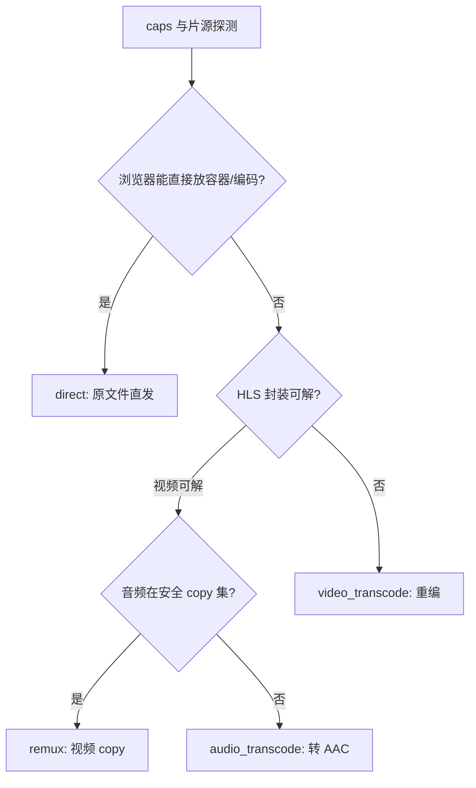

# 播放核心设计

[开发者文档](README.md)

## DLNA 接收端播放

`app/casting/dlna.py` 通过 SSDP 搜索 MediaRenderer，读取设备描述，再调用 AVTransport 与可选 RenderingControl。浏览器只调用本服务 API，不直接发送组播或访问电视控制端口。搜索结果的描述及服务 URL 限于响应来源的私有 IPv4；手动添加要求描述 URL 指向私有 IPv4，随后验证实际 MediaRenderer 与 AVTransport。两条路径都禁用 DNS、代理和重定向，限制响应大小与等待时间并拒绝 XML DTD；发现数量与会话数量有上限。接口约定见[投屏 API](api.md#dlna-投屏)。

`app/casting/service.py` 为电视建立独立随机会话，复用现有源文件解析及 Range 读取，不使用手机的 caps/HLS sid，也不对 DLNA 自动转码。ConnectionManager 提供的格式列表可提前排除不支持的 MIME，不能证明具体编码、HDR、字幕或音轨能正常播放。通过 `SetAVTransportURI → Play → 可选 Seek` 请求起播；命令成功与电视实际上报的状态分开。

每设备锁串行化起播、控制和后台轮询，避免旧会话污染新的播放。新投屏成功设置 URI 后废弃同电视的旧会话。服务器每轮等待 5 秒后检查活跃会话，即使手机关闭也记录实际位置；位置接口不可用时仍保留 transport 状态，空 URI、无效位置、停止时重置到零不写伪进度。起播状态有 30 秒宽限，连续六次 transport 失败停止监控；不发送停止命令。轮询周期还受设备响应耗时影响，不是精确实时同步。

`PlayerModal` 恢复当前投屏后阻止手机自动起播；开始投屏前等待本地进度写入，成功后作废本地 reload、停播断源、关闭 HLS 与字幕渲染，禁止本地位置覆盖电视断点。“手机播放”先成功停止电视再重建本地播放。设备面板使用独立取消代际，关闭面板只取消搜索；全屏内将设备面板挂到全屏容器，复用 `JzDialog` 焦点管理。文件预览没有投屏入口。当前不提供投屏自动连播与网页字幕同步。

回归：`tests/test_casting.py` 使用本机隔离 SOAP 接收端，覆盖 SSDP 响应、手动注册、地址与 XML 校验、命令、电影/分集、Range/HEAD、进度归属、鉴权和清理；`frontend/tests/casting.test.js` 覆盖请求代际、手动添加、离开与失败状态。`node scripts/smoke_casting.mjs` 使用合成视频、真实 FastAPI/FFprobe/PlayerModal 和模拟接收端，检查桌面及 390/375/320px 手机流程，输出位于 `output/playwright/casting/`。真实电视仍需分别验收屏幕声画、其他接收端、长时间播放及目标部署网络；自动化和电视状态回报不能代替这些观察。

## 从能力到播放计划

`app/media.py` 用 ffprobe 得到容器、编码、帧率、音字幕轨、HDR/DV 等，结果在 `media_info` 按 `(kind,item_id)` 缓存；当前 `PROBE_VERSION=4`，探测版本落后时在播放前重新探测。前端 `caps.js` 检测浏览器格式能力，`POST /api/stream/{id}/decide` 上传 caps；不带 caps 的 GET 兼容口使用保守默认。`app/caps.py` 规范/哈希能力，`app/playback/plan.py` 决定：

| 方式 | 视频 | 音频 | 典型原因 |
|---|---|---|---|
| `direct` | 原文件直发 | 原文件默认轨 | 容器、编码及轨道均可浏览器直放 |
| `remux` | copy | copy | 内容可解，但容器/选轨需改为 HLS |
| `audio_transcode` | copy | 转 AAC | 视频可解，音频不在安全 copy 集合 |
| `video_transcode` | 重编 | 按需 copy/重编 | 视频编码、尺寸或 HDR 路径不适合直通 |

画质 `auto/source/1080p/720p` 会影响输出尺寸和会话复用；`auto` 只在需要视频重编且源高度超过 1080 时封顶为硬件 1080p、软件 720p，copy 路径保留原尺寸。`source`（原画）取消自动封顶，格式不兼容仍需转换，不能保证免重编；旧 `original` 按 `auto` 兼容。切换画质可能重开会话，不属于无缝 ABR。网页对 HDR10/HLG、带 HDR10 基底的 DV P8.1，在客户端可解 PQ 时允许直通；DV P5 无兼容基底阻止直通。硬件后端可 tone map，软件退化路径会给原因提示。

数值例子：某片从 125.5 秒续播，目标前最近关键帧在 124.0 秒。copy 会话返回 `media_start=124.0`、`initial_time=1.5`：播放器片内 0 对应原片 124.0 秒，起播落在片内 1.5 秒处。字幕 cue 存的是原片时间，逐帧用 `media_start + 片内时间` 判定是否显示，再叠加用户设置的延迟。

### 浏览器检测与兼容回退

网页 `caps.js` 分别检测 `media-source` 和 `file` 解码能力；主 `video/audio/probes` 用于所选流式引擎，`file` 保存独立的原文件能力与逐片探测。服务端先按文件能力检查 MP4 直发，不能用 MSE 的否定结果阻止原生视频播放。新客户端使用 v4 能力缓存，旧客户端不带 `file` 时保留原决策。

MSE 接口及基础 MP4 编码可用时优先 hls.js；现代 Safari 保留原生 HLS。无可用 MSE、但声明原生 HLS 的其他浏览器使用 `hls_compat=true`：按当前客户端输出音视频合并的 TS，视频只 copy H.264 8-bit，其余重编；音频只 copy AAC 单/双声道，其余转 AAC 双声道。这个原生 HLS 声明不意味着具备 Safari 的 Dolby、HDR 或音轨 API，网页另传 `native_audio_tracks`。TS 切音轨重开会话，封装与所选音轨参与产物复用键，不需要全局修改 `HLS_SEGMENT_TYPE`。

hls.js 加载失败或不可用时，若浏览器声明原生 HLS，播放器尝试上述兼容路径；媒体解析/解码失败时尝试一次兼容重播，原文件解码失败会撤销源编码支持并重编。`force_hls` 只影响当前播放器，基础能力缓存不变；自动重播每个版本最多一次，保留位置并回收旧 sid。网络失败不触发格式降级。组件加载失败与浏览器格式不支持分别提示，调试信息包含 UA、能力、源编码和实际输出。

无 MSE 的小米浏览器使用 `mp4_compat`，尝试恢复网页内播放。服务端输出 30 秒的普通 MP4，只有 FFmpeg 自然成功退出、完整索引生成后才原子发布 `media.mp4`；HTTP 使用不可变文件与 Range。服务端从完成文件探测并缓存实际 `clip_duration`，网页收到会话即预取下一片，不依赖浏览器的 `duration/loadedmetadata`。保留原片总时长及 `media_start + currentTime`；片段结束只衔接下一片，不发电影结束/已看事件，`ended` 属性轮询补足缺失事件，并防重复和旧源晚到事件。字幕继续客户端渲染并叠加源偏移；切轨/画质/seek、关窗取消预取并删除迟到 sid。没有 MSE/原生 HLS、但能解 H.264/AAC 文件的其他浏览器也可使用此输出。

网页将 `media_url` 下载为 `video/mp4` Blob 后挂到媒体元素，减少厂商按视频 URL 接管的机会；每片最多 64 MiB、下载限时 45 秒，超限或失败显示可重试提示。仅保留当前和下一片，断源后或取消预取时撤销对象 URL。浏览器模式切换后的 MSE/原生 HLS 探测结果进入能力缓存环境指纹，刷新可重新决策。

MP4 短片的完成标记只表示当前片段完成，不能作为 start=0 全片缓存复用于远处 seek；起点、片长、音轨和源修订进入产物键。首段生成或预取未完成时会等待，尤其弱服务器或倍速播放；此路径不提供整片预缓存。新编码规则使旧产物键失效。

原生媒体播放时有画面、`readyState>=2`、未暂停，但网页时间长期不动且没有缓冲信息时，停止反复重挂并尝试 MP4；若仍是独立播放器则明确提示，暂停进度写入，不能用墙钟伪造进度或字幕时间。视频请求行内播放、禁用远程播放入口；浏览器自带浮层不属于网页 DOM，不能承诺这些属性一定隐藏厂商控件。

厂商浏览器仍需验证首帧、连续片段、seek、切音轨、全屏字幕及关闭清理。回归为 `caps.test.js`、`mp4Chunks.test.js`、`playbackCompatibility.test.js`、`test_playback_plan.py`、`test_stream_mp4.py`、临时视频真实 FFmpeg 的 `test_playback_compat.py`，以及 `scripts/smoke_settings_ui.mjs --player-only`。浏览器模拟与合成视频验证不能代替真实小米浏览器验收。

## HLS 与 FFmpeg

`playback/cmd.py` 组命令，`transcode.py` 检测 VAAPI → QSV → NVENC → 软件，首轮硬件 45 秒仍不出片时软件重试。默认 fMP4 HLS，每片目标 4 秒，`HLS_SEGMENT_TYPE=ts` 回退目标 6 秒的旧 TS。fMP4 单 FFmpeg 进程产生视频和最多 8 条音轨 rendition；服务端写 `master.m3u8`，`CODECS` 包含整个音频组的实际输出编码并集。ffmpeg 继续增长的 `out_*.m3u8` 应按内容快照返回，不能直接用按旧长度计算 Content-Length 的 `FileResponse`。FFmpeg 工作目录必须是产物目录，因为分片输出文件名是相对路径。

fMP4 HLS 音轨通过 rendition 切换，一般不重开会话；网页原文件直发依赖实际 `video.audioTracks` API，没有此 API 时选择非默认轨会转为 remux。hls.js 音频 copy 默认仅 AAC/MP3，EAC3/AC3 转 AAC；Safari 原生 HLS 可支持更多 Dolby 格式，其他原生 HLS 的兼容 TS 使用 AAC 单/双声道。Android TV 则根据声明的原生选轨能力判断。`AUDIO_COPY_SAFE` 只应在目标设备实测后放宽。

音轨切换在 hls.js `MANIFEST_PARSED` 和 `AUDIO_TRACKS_UPDATED` 后应用，前者触发时列表可能尚空。源轨 default 与用户 UI 选择分离，非烧录字幕切换不应让音视频重新编码。copy 首屏等一个视频分片，视频重编/烧录等两个，不能把音频片计入视频可播放判断。

### 按需生成窗口

普通 HLS 会话按客户端需求控制 producer，`TRANSCODE_LOOKAHEAD_SECONDS` 默认 120 秒：已生成的视频末端超前需求达到高水位时暂停 FFmpeg，降至半数低水位后恢复。控制器每 100ms 检查完整视频分片；GOP、巡检间隔和在途分片可能使超前量超过目标，很短且生成极快的片源也可能在首次巡检前完成，因此这不是绝对 120 秒上限。fMP4 和 TS 共用此控制，有限 MP4 兼容片段仍自然完成后发布；播放格式、产物键和完整缓存复用规则不变。

网页心跳可携带原片绝对秒数 `position`、`paused` 和范围 0.25～4 的 `playback_rate`；旧客户端可继续发送空请求体，服务端以该持有者已请求的视频末端保守估计需求，音频 rendition 和播放列表刷新不推进消费位置。此估计不等同于旧客户端实际正在观看的位置。同一产物按仍持有会话的各客户端需求汇总，释放某个持有者后移除它的需求并重新计算。存在独立预缓存持有者时允许全片生成，预缓存结束或释放后恢复普通窗口控制。

支持 `SIGSTOP` / `SIGCONT` 的平台暂停、恢复同一 FFmpeg；暂停期间仍占用进程额度并保护其产物目录，实际 CPU 已让出，手动缩略图任务可继续。停止任务前先恢复暂停进程，再按原流程终止和回收，不能把暂停写成任务完成。平台不支持这两个信号时保留原生成行为，诊断标记 `window_supported=false`。参数取值和禁用方式见[播放与缓存配置](../getting-started/configuration.md#播放与缓存)。

水位控制与读取限速独立。输入沿用原读取参数，需要额外限制 HLS 视频重编码读取速度时可显式设置 `TRANSCODE_READRATE`；复制流仍保持原读取方式。预缓存加入已有普通 producer 时解除水位暂停，已有输入读取参数继续沿用；关闭预读窗口不改变手动读取速率设置。

HTTP 主输入启用当前 FFmpeg 支持的有限断链重连，恢复仍取决于片源的 Range 读取能力和网络；缺少所需重连参数时，此类输入保留原生成行为，并以 `window_supported=false` 标明。暂停和重连不更换源、产物键或当前任务的持有关系。持续断链仍可能使任务中断，由心跳的 `failed` 和播放诊断反映，客户端重新建立会话，不能宣称任意远程连接都可无缝恢复。

## 会话时间轴与清理

`POST /sessions` 返回源时间轴起点 `media_start` 和会话内起播位置 `initial_time`。copy 会话起点可落在目标前关键帧；客户端进度和字幕必须把片内时间换回原片时间。先在缓冲或 seekable 范围复用；范围外重开会话；完整的 start=0 成品可被续播命中。

### 客户端会话与共享产物

每次成功创建都返回新的客户端 sid；服务端 `_sessions` 保存各客户端持有关系，`_tasks` 在锁内按 `(kind,id,完整产物键)` 共享 FFmpeg 任务。完整键包含源路径/size/mtime、实际输出 plan、封装、烧录字幕及精确起点，目录名带 SHA-256；同一 fMP4 的所选音轨、非烧录字幕和仅名称不同的同输出画质不会拆出重复产物。旧非哈希目录不迁移，由缓存回收规则清理。

### 并发额度与释放

DELETE 或会话超时只释放该 sid，最后持有者离开才停止仍在运行的 FFmpeg；预缓存任务也有独立持有者，关闭普通播放器不会取消明确启动的整片预缓存。`MAX_TRANSCODES` 默认 2、范围 1–8，对新产物的初始化到进程退出全程占额，窗口暂停也不提前释放额度；加入已有产物或使用完成缓存不重复占额，满额的新请求返回 429。不能为一个客户端清理会话而杀掉其他设备共享的任务。

网页播放器在主会话请求中传同一播放器实例的 `client_id` 和递增的 `request_seq`。方向键连续 seek 时，较新请求会撤销该实例更早的会话，包括尚未返回 sid 的 POST；旧请求如果晚于新请求抵达，返回 409。清理只释放旧请求的持有关系；其他播放器或预缓存仍持有同一产物时，FFmpeg 继续运行。未传这两个可选字段的客户端仍按独立 sid 工作。

### 认领、保活与关闭

playlist/分片读取和心跳都认领并保活；未认领会话宽限 90 秒，已认领空闲 600 秒后可回收，进程已退出的会话闲置 300 秒后也可回收。应用 lifespan 在清理孤儿进程后启动会话维护线程，默认每 60 秒巡检，释放持有关系和任务结束会唤醒维护。删除超时会话前在同一锁内重新检查失活条件，避免候选扫描后到达的心跳被忽略；不依赖下一次播放请求触发回收。

前端用 `disposed`、`reloadGen`、AbortController 守护异步请求，关闭窗口前显式 pause、断开 src 并 load，迟到会话立即 DELETE。关闭请求未送达时，由上述失活期限及下一轮巡检兜底。退出 lifespan 先停止维护线程，再调用 `shutdown_sessions` 清转码子进程；重入 lifespan 不得重复启动或复活仍在停止的旧线程。修改任何 await 路径后要审查晚到响应和双 HLS 实例风险。

### 缓存占用与回收

`DATA_DIR/transcode` 保存播放分片、字幕和字体，`DATA_DIR/previews` 保存缩略图，两者独立统计、独立清理。播放缓存采用 24 小时 TTL，容量维护按 5 分钟节流执行；有足够可淘汰目录时，超出 `TRANSCODE_CACHE_GB` 后按旧到新回收到约 90%。正在初始化、运行、窗口暂停或仍被客户端使用的目录，以及新建保护期内的目录，不参与容量淘汰。删除失败不计入已释放空间，成功后使应用数据占用统计失效。

容量是软淘汰目标：保留活动会话的全部已生成分片和整片预缓存时，活动内容本身可能超过配置值。预读窗口只约束提前生成量，不会删除已经播放过的历史分片，也不构成硬磁盘配额；会话释放后由后续维护回收。不能为了满足限额而删除其他客户端正在读取的分片。

设置页“系统维护 → 应用数据与缓存”通过 `/api/cache-settings` 保存总预算与其中两项缓存额度。`app/cache_settings.py` 统一提供实时有效值：数据库保存值优先，未保存时播放/缩略图额度回落各自环境变量，总预算默认 20 GB。读取保留旧超配组合和播放额度 0；联动校验只在保存时执行，要求两项正额度加最新基础数据预留不超过总预算，统计失败不保存。预留算法与错误响应见[容量接口](api.md#容量含义)。

总预算是软上限，达到后提醒并暂停闲时预览，不阻止必要的数据写入，也不因超配强制删除内容。占用统计缓存不缓存总预算，修改后直接重算超限状态，并唤醒闲时队列检查；调低额度后的回收仍由既有维护执行，不在保存请求中删除内容。实际缓存占用超过新额度不阻止合法保存，基础数据增长也不自动缩减分项。[分配与清理操作](../user-guide/settings.md#调整应用数据与缓存)。

## Android TV 与观看进度

Android TV 使用协议 1 握手和 `client=android_tv`，显式声明原生容器、HLS、音轨选择、HDR 和逐片解码能力，不借用网页的 `mse/native_hls` 判定。源文件可解且容器可读时可直接播放 MKV；HLS copy 仍受设备声明的 `hls_audio` 约束。文本字幕使用 WebVTT；声明 `subtitles.ass=true` 的 APK 通过现有 `.ass` 和字体接口使用原生 libass 渲染 ASS/SSA，保留字体、样式、位置和动画，失败时提示并回退同轨 WebVTT。旧 APK 或旧服务端继续使用兼容文本路径，图片字幕烧录。原生 HLS 的起播仍严格区分 `media_start` 与 `initial_time`，详细协议在仓库 `android-tv/docs/protocol.md`。

服务端 `app/playback_completion.py`、网页 `frontend/src/progress.js` 和 APK `PlaybackModels.kt` 统一完成条件：已播至少 95%，或已播至少 80% 且剩余不超过 300 秒。非法位置、未知时长和非有限数不算完成。3 分钟短片在第 60 秒暂停仍应继续观看，第 144 秒才满足条件；阈值不等同于播放器真正触发 ended/下一集。剧集最近播放项的 `id/show_id` 是剧 ID，续播使用 `progress.version_id` 的分集 ID，并传 `kind=episode`。

## 字幕、预览与预缓存

### 播放控件与快捷面板

画面右上角使用设置、投屏、全屏白色图标与共享顶部渐变；标题栏保留片名与关闭。窗口态底栏保持可见，画内工具播放时闲置淡出；全屏上下控件统一显隐。显示计时、交互和焦点规则见[播放器界面规范](design-system.md#播放器)。底栏提供播放、前后 10 秒、音量、倍速和字幕/音轨六个控件，手机时间独立成行，触摸区域至少 44×44 CSS px。倍速和轨道选择各有直接入口，画质、字幕延迟/外观/兼容与播放信息保留在播放设置；这些选择继续调用现有播放和字幕逻辑。

音量图标打开向上的竖向面板，桌面支持悬停，点击用于触屏与键盘；百分比、静音按钮与滑条分开。浏览器拒绝修改媒体音量时提供系统音量键提示并保留静音。音量、倍速、轨道和设置面板互斥；打开面板或键盘聚焦时保持控件可见，显式关闭时恢复可见触发器焦点。临时悬停的音量面板在鼠标移出后收起，不抢焦点；点击固定、键盘聚焦或拖动期间保持打开。全屏面板留在全屏容器内，不能挂到全屏树之外。

隔离验收使用 `node scripts/smoke_settings_ui.mjs --player-only` 检查桌面、390/375/320px 手机、触摸和全屏控件，继续覆盖真实 ASS worker、字幕画面及播放器关闭清理。投屏设备面板另由 `node scripts/smoke_casting.mjs` 验证；模拟布局和能力检测不能替代手机浏览器的音量限制及真实电视验收。

### 字幕渲染

`useSubtitles.js` 用自绘 DOM 层显示 SRT/VTT，失败回退原生 track；JASSUB 渲染 ASS/SSA 并尽量保留样式，libpgs 渲染 PGS，失败可降级烧录；VobSub 走烧录。自绘文本层在画中画中不可见；ASS 缺 CJK 字体可补 `DATA_DIR/fonts/` 内有权使用的字体，或降级 VTT（丢失原样式）。内嵌字体在首次请求时从片源解出：逐附件流显式输出后改名（ffmpeg≥7 拒绝中文/括号内嵌文件名做落盘名，整批按内嵌名解出零文件），同目录并发只跑一次；JASSUB 字体预检不通过或初始化失败/超时，自动降级同轨 VTT 并提示（本地临时 ASS 无服务端 VTT 变体，只提示不降级）。

网页 ASS 的专用入口 `jassubWorker.js` 在注册原 JASSUB RPC worker 前，通过 `assCanvasContext.js` 将该 worker 的 WebGL/Canvas2D 上下文 `desynchronized` 设为 `false`，让透明字幕画布参与常规合成；保留透明度、WebGL 加速和 ASS 样式，不修改依赖包或页面中的其他画布。此设置针对手机全屏时字幕可见、底下视频黑屏的合成兼容路径，不改变播放计划。`scripts/smoke_settings_ui.mjs --player-only` 用合成视频、ASS 和字体检查真实 worker 的上下文属性、手机布局下窗口/竖屏与横屏全屏的画面及字幕像素、兼容模式往返和关闭清理；浏览器模拟通过仍需受影响手机验收。

字幕源时间相对 HLS 会话应叠加 `media_start + subDelay`；延迟按版本保存，外观按浏览器保存。外挂轨从 `scanner.classify` 归属，临时本地字幕仅浏览器持有，关闭失效。

### 倍速、缩略图与预缓存

六档倍速由浏览器 `playbackRate` 实现，保持音调；换元素/会话需恢复。`usePlaybackPreviews.js` 与 `stream/previews.py` 管理逐页拼图，GET 不启动生成，POST 可手动生成。字幕、预览、seek 的所有 UI 时间都以原片时间表示。

`stream/preview_extract.py` 对本地文件优先使用输入侧 `-skip_frame nokey`，按页批量提取经缩小与 HDR 色调映射的候选画面，再拼成 5×5 图片。完整采集的帧编号和时间戳不受诊断日志尾部长度限制；候选 PNG 数量、顺序编号和时间戳必须一一对应。匹配时保留 HEVC 解码可能产生的乱序、重复及负时间，按目标时间选最近候选，同一画面可用于多个相邻采样格，偏差仍不得超过一个采样间隔。每页输入窗口和候选数量均有上限，临时小图在结束、取消或播放让行时清理。

候选画面、附近补抽和精确抽帧均保存为 `rgb24` PNG，避免拼图前先做一次 JPEG 有损压缩。最终拼图只进行一次 JPEG 编码，使用 `q:v=2` 和 `yuvj444p`，减少量化与色度抽样造成的细节损失。单格仍为 160×90 像素；这项调整不恢复缩放或片源本身已经丢失的细节，也不改变采样间隔与时间校验。

只对未覆盖的采样格使用 `-noaccurate_seek` 从索引位置取得附近画面；该路径保留正常解码，避免部分 HEVC 的跳帧解码遗漏附近画面，仍校验实际输出时间。混合页中的单点失败仅对该点精确抽帧，不使后续页面永久放弃批量。批量执行失败或无法核对任何候选时，当前影片改用逐点取帧，再按需精确回退。正常完整页需要一次候选抽取和一次拼图；回退与每页日志记录任务、媒体 ID、页码、策略、复用/补抽数量及安全错误摘要，不记录原始片源 URL 或凭据。远程库（含挂载路径）保持逐点精确输入侧 seek，HTTP 输入复用 `media.probe_limit_args` 限制重复探测。`PREVIEW_MODE=accurate` 可强制精确路径；参数细节见[配置参考](../getting-started/configuration.md#播放与缓存)。

硬件解码跟随 `TRANSCODER`，用实际片源尝试 VAAPI/QSV/CUDA 解码，失败后当前影片改用软件，不依赖 H.264 编码冒烟结果。HDR 色调映射前的缩放保持宽高为偶数，满足 YUV420 的色度采样尺寸要求。解码线程数默认 2、最多 4，滤镜和拼图仍为单线程；任务保持低优先级、全局单并发。子进程用带超时的 `wait` 等待，结束立即唤醒，每 200ms 检查取消和播放让行；自动任务遇播放取消，立即批量任务遇实际运行的在线转码终止当前页并等待后重做，窗口暂停的 producer 不阻塞手动生成。只有成功且时间校验通过的完整页才原子提交，续做跳过当前画质修订下已提交的页；页内帧已计数但尚未提交时遇到让行，显示的帧数可能暂时保持，不能据此判断任务卡死。

清单格式 `VERSION` 保持 1，画质规则独立使用 `QUALITY_REVISION=2`，参与缓存标识并写入新清单。新旧画质使用不同图片 URL，避免覆盖已声明 `immutable` 的旧图。GET 在新清单尚未完整时可回退到旧版完整成品，整套返回、不混用新旧页；生成、入队和完成对账只认当前画质的缓存。新版全部页面和完整清单保存成功后，按同一片源、采样配置的缓存键直接删除较旧画质修订；命中已完整的新缓存时也补做清理，删除失败只记录日志，不使新版生成失败。取消或失败保留旧图，其他片源修订和采样配置仍由缓存限额管理。升级和读取清单均不自动全库重建。更新已有预览的入口和完成后重新打开播放器的要求见[进度缩略图教程](../user-guide/playback-previews.md#生成进度缩略图)。

扫描前后比较电影、分集和花絮 ID，仅将新入库项写入 `DATA_DIR/previews/auto-queue.json`；重启恢复队列，默认服务器本地时间 03:00–06:00、无播放会话时生成。已有入库项不因升级自动全库回填。`PREVIEW_AUTO_MODE=off|local|all`（默认 `all`），`PREVIEW_AUTO_START_HOUR` / `PREVIEW_AUTO_END_HOUR` 缺省 3/6，相同小时表示全天。应用数据总占用达到总预算（默认 20 GB），或缩略图占用达到自身额度的 90% 时，自动队列暂停。缓存按源标识、大小、mtime 和规则失效，与 24 小时转码缓存分开；未在网页保存时默认 `PREVIEW_CACHE_GB=10`。远程适用版本通过 prewarm 预缓存 start=0 的 HLS 成品，质量计划一致才复用。

维护队列合并即时批量任务未领取项与持久闲时队列并去重，成功生成后同步退队。worker 在 `_lock` 内逐项领取实时任务列表，移出操作与领取互斥，保存失败则两处队列均保留；批量全选覆盖分页并保护已领取的当前项。历史遗留的完成项通过节流对账校验当前源的缓存键及完整页，不启动媒体探测或生成。前端在存在待处理项时持续短轮询，变更操作期间暂停轮询并作废旧请求，完成后重新获取队列。

失败信息独立保存在 `DATA_DIR/previews/failures.json`，按 `(kind,id)` 保留最近一次未解决失败；手动、批量和闲时生成共用记录逻辑，成功后清除，取消、让行和成功的策略回退不算失败。公开原因使用安全错误码与中文说明，不保存原始片源 URL 或 FFmpeg 日志。持久任务失败后先保存原因再退队；保存异常按 30 秒退避重试保存，期间不再次启动抽帧。

失败清单的手动重试复用 `auto-queue.json` 持久队列，并标记为手动请求，旧条目仍按闲时任务处理。请求追加队尾，当前任务不被抢占；调度选择首个可执行项，跳过暂不符合条件的闲时项，手动重试不受自动生成开关或时段限制，沿用批量生成的转码让行规则。队列中的完成、失败退队与取消按媒体身份匹配，不依赖队首位置；显式取消先持久退队再停止，服务关闭则保留未完成请求以便恢复。失败与重试接口约定见[容量与预览维护接口](api.md#容量含义)。

面向普通用户的步骤与效果说明见[播放器任务教程](../user-guide/player.md)。
